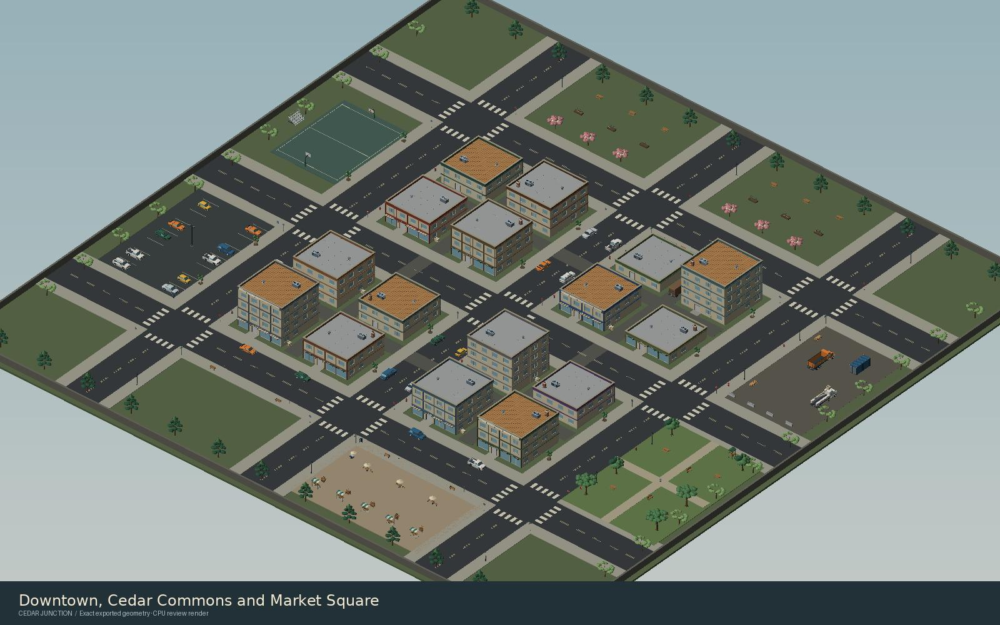

Can AI build a game from footage alone?

## Cedar Junction city level

The default world is now an explorable American downtown assembled from the
[low-poly item collection](https://github.com/RHS059/low_poly_items): 16 enterable
buildings, furnished shops, 41 occupied floors, 25 stair connections, streets,
alleys, parking, a market plaza, and Cedar Commons park.

Choose **ENTER WORLD** at launch, or use `--level=cedar_junction`.
The original test range remains available with `--level=range`.

[Level guide and controls](docs/CEDAR_JUNCTION.md) ·
[Geometry review images](assets/levels/cedar_junction/review/) ·
[Build and validate the city](.github/workflows/build-city.yml)

## Weapon animation authoring

Update the same [canonical weapon BLEND](assets/authoring/weapon_animations.blend).
The [NLA export and runtime guide](tools/nla_export/README.md) explains per-track
FBX export, automatic runtime coverage, playback ranges, and inspecting preserved
historical Actions.

## Native renderer

The game uses wgpu exclusively: DX12 by default on Windows, with explicit
`--renderer=auto|dx12|vulkan|metal` selection. OpenGL and Macroquad have been
removed, including wgpu's optional GLES backend. `--renderer=gl` is rejected
before a window is opened. CPU asset tools remain available with
`--no-default-features`; ordinary game builds default to `audio,wgpu-runtime`.

`--renderer-build-info` prints the compiled backend set without opening a window.
Windows CI checks that exact release executable, its selected Cargo dependency
closure, and known GL loader/library markers before packaging. The receipt is
retained in the quality-check artifact as `wgpu-only-release.json`.
