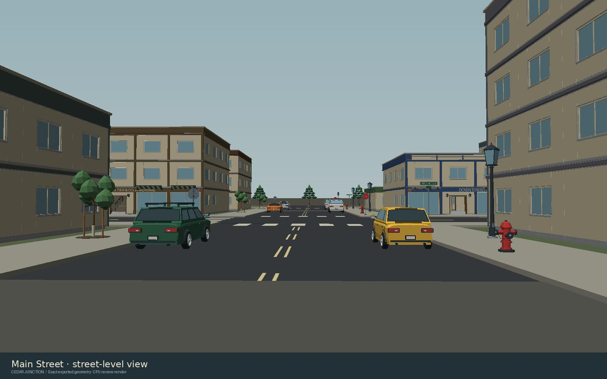
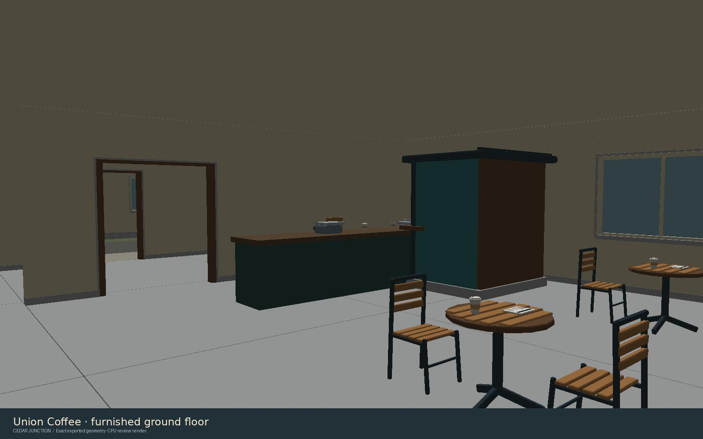

# Cedar Junction

Cedar Junction is the default explorable city level in Rust Duty. It combines
meshes from the project owner's `RHS059/low_poly_items` collection with an
original street plan, building shells, floors, collision, and circulation.

## Play

Launch the game and choose **ENTER WORLD**. Use WASD to move, the mouse to look,
Shift to sprint, and Space to jump. Ctrl/C crouches, Z goes prone, right click
aims, left click fires, and R reloads. Esc opens the pause menu. F2 resets the
current city and returns to its spawn; death also respawns in the city.

The level contains a street grid, alleys, a park, municipal parking, and a market
plaza. Its 16 enterable buildings contain 41 occupied floors and 107 named rooms
or shop spaces; 14 buildings have multiple stories. The 32 street and service
entrances lead to furnished interiors, with 25 stair connections between floors.
Doors are open passages. There is no separate door interaction required to enter
them.

Level selection is explicit at launch:

```sh
vector-range --level=cedar_junction
vector-range --level=city
vector-range --level=range
```

The first two names select the city. The last selects the previous movement test
range. `RUST_DUTY_LEVEL` accepts the same names; a command-line selection takes
precedence. There is no in-game level selection menu.

The scripted `--capture-sequence`, `--capture-fixtures`, and `--capture-supply`
checks retain the test range unless a CLI/environment level is explicit. Other
capture modes use the ordinary city default. City render traces identify
`scene.name` as `cedar_junction`.

## Runtime files and reproduction

Keep `assets/levels/cedar_junction/level.json` and `meshes.bin` beside the game in
the supplied directory tree. Both files are required in fresh builds, managed
update bundles, and Windows previews. Missing or invalid city data produces a
clear startup error; `--level=range` remains available for the test range.

The loader first checks the executable's managed asset tree, then the source
tree for development runs. `level.json` contains spawn, collision, named
landmarks, and building route metadata. `meshes.bin` stores the transformed
mesh geometry and colors, bounded in chunks with 16-bit indices. The mesh file
uses deterministic gzip compression; the loader validates its checksum and
limits decompression to 256 MiB before decoding the mesh stream.

To regenerate from the source checkout pinned in `tools/city_source_lock.json`:

```sh
python tools/build_city.py --source ../low_poly_items
python tools/validate_city.py --root . --source ../low_poly_items
```

The builder requires NumPy and Pillow. The review renderer also requires Numba. The source lock records the repository commit and
SHA-256 digest of every used GLB. `layout.json` records individual source-mesh
placements and building metadata. These authoring files and original GLBs are
not copied by the runtime package allowlist.

## Verification scope

`tools/validate_city.py` independently checks mesh framing, indices, finite
vertices, normals, colors, bounds, the level/mesh digest, source asset placement
inventory, and declared geometry statistics. With `--source`, it also verifies
the source checkout commit and each used GLB's bytes.

Entrance and stair paths are sampled at intervals no greater than eight
centimeters against the actual level collision boxes. The probe uses the game's
standing dimensions (radius 0.381 m, height 1.778 m) and step limit (0.4573 m),
requires floor support, checks head clearance, and checks stairs in both
directions. Every declared upper floor needs a connecting stair. This is a CPU
structural and collision-clearance check; it does not establish native rendering,
visual quality, controller feel, sound, or performance on a player's GPU.

The level layout and supporting code are newly authored for this game. Source
asset provenance remains tied to `low_poly_items`; conversion does not create a
new license or extend the source collection's usage rights.

## Committed level review

The city uses 125 unique catalogue models in 5,387 placements. The independent
clearance audit passes 189 routes sampled at 22,757 positions. A separate Rust
integration test loads the shipped geometry and moves the real player through a
shop entrance, up a switchback staircase, and into an upstairs room, then checks
that reset restores the city spawn.

The following are depth-tested CPU renders of the runtime geometry, not native
Windows screenshots. Native GPU performance has not been measured.




